<p align="center">
  
</p>

<h1 align="center">MusicTrad</h1>

<p align="center">
  Les paroles de la chanson qui joue dans <b>Musique</b>, traduites en français, ligne par ligne.<br>
  Petite app macOS de barre des menus, en Swift/SwiftUI, sans aucune dépendance.
</p>

<p align="center">
  <a href="https://github.com/Ligrade/MusicTrad/releases/latest"><b>⬇︎ Télécharger MusicTrad 2.0 (.zip)</b></a>
</p>

---

## Ce que fait l'app

- **Détecte le morceau en cours** dans l'app Musique (titre, artiste, album, durée, position) par AppleScript : toutes les 0,5 s quand les paroles sont affichées, sinon seulement quand Musique signale un changement (quasi 0 % de CPU bulle fermée).
- **Récupère les paroles** sur [LRCLIB](https://lrclib.net), une API publique et gratuite, en préférant les paroles synchronisées ; si LRCLIB n'a pas de version synchronisée cohérente, l'app interroge aussi NetEase Cloud Music, en parallèle.
- **Traduit en français** chaque ligne, avec la traduction affichée sous l'original, au fil de l'eau :
  - **Apple** (par défaut) : traduction sur le Mac avec le framework Translation, gratuite, hors ligne et privée ;
  - **DeepL** (option) : avec ta clé API gratuite, rangée dans le Trousseau.
- **Choisit la bonne version** : quand LRCLIB a plusieurs fichiers synchronisés, l'app garde celui dont le timing s'accorde avec la majorité (les copies décalées sont écartées).
- **Suit la chanson** : la ligne chantée est mise en avant et la vue défile toute seule. Un clic sur une ligne fait repartir Musique à ce passage.
- **Vérifie la synchro** : un voyant indique si le timing des paroles colle au morceau, avec un recalage en un clic sur la ligne entendue, un décalage réglable par morceau et le choix d'une autre version ou source.
- **Marque les passages instrumentaux** : ♪♪♪ qui s'allument au fil du solo, même quand le fichier de paroles ne les indique pas.
- **Prépare le morceau suivant** à l'avance (playlist en cours, ou titre suivant de l'album via l'API publique Deezer).
- **Chanson en français** : pas de traduction par défaut ; un réglage permet de la traduire en anglais (le français reste en blanc, l'anglais passe en rouge).
- **Traduction à la demande** : rien n'est traduit tant que tu ne cliques pas sur la pilule **EN → FR** (un son déjà traduit s'affiche directement) ; re-clic : paroles originales seules ; **clic droit** : traduction automatique (indicateur ∞, aussi dans les Réglages).
- Affiche la **pochette** (un clic ouvre l'album dans Musique ; grise en pause), l'**artiste** (un clic ouvre sa page dans Musique), une **étoile favori** synchronisée avec Musique, un **cœur** pour sauver la traduction du son (jamais supprimée), les commandes **⏮ ⏯ ⏭** et le choix de la **sortie AirPlay**.
- **Musique fermée ou à l'arrêt** : un bouton rouge ♫ ouvre Musique ; sans lecture en cours, **Ma station** (ta station personnelle, lien à coller dans les Réglages) ou **Mes likes** (tes morceaux préférés).
- **Fond couleur de l'album** : derrière les paroles, la pochette floutée et assombrie, en fondu au morceau suivant (ou fond noir, au choix dans les Réglages).
- **Lecteur réduit** (chevron ⌃ en haut à droite) : la bulle se replie en petit lecteur carré, centré sous l'icône : pochette, titre, artiste, barre de lecture (clic ou glisser pour avancer) et commandes. Aussi sobre que le mode éco : ni paroles, ni traduction, ni préchargement ; les paroles reviennent au dépliage.
- **Pochette animée** (option dans Réglages › Affichage) : quand l'album en a une sur Apple Music, la vidéo remplit le lecteur réduit, comme le lecteur plein écran de l'iPhone. Elle continue d'un son à l'autre du même album, se voile au survol pour bien voir les commandes et se met en pause en pause, bulle cachée ou quand une autre fenêtre passe devant.
- **Sons déjà traduits** (pilule 💽 à côté de la langue) : la liste des morceaux traduits avec leurs pochettes (Musique, iTunes puis Deezer) et une recherche ; un clic pour relire paroles et traduction, ▶︎ pour l'écouter tout de suite, ♥ pour garder ces paroles pour toujours (jamais supprimées du cache). La place restante et la règle de suppression sont affichées en haut.
- **Clic droit sur l'icône** de la barre des menus : « Paroles + traduction » (quitte le lecteur ou le mode éco et traduit tout de suite ; déjà sur les paroles : traduit seulement), Réglages…, Quitter.
- **Présentation des fonctions** au premier lancement, page par page, qui finit par le choix du style : fond couleur de l'album ou noir, pochette animée oui/non (à revoir dans Réglages › Général).
- Garde paroles et traductions en **cache**, avec un nettoyage automatique.
- **Veille automatique**, bulle fermée : avec de la musique, les paroles laissent place au lecteur (après 30 min par défaut) ; sans musique pendant 15 min, **mode éco** : l'app reste dans la barre des menus (bulle avec une petite feuille) mais ne consomme plus rien, et revient en lecteur dès que la musique reprend (ou via la note verte). En marche, bulle fermée, elle tourne autour de 1 % de CPU.

Aucune API de paroles d'Apple n'est utilisée (il n'en existe pas pour les développeurs), ni aucun jeton privé d'Apple Music.

## Prérequis

- Mac Apple Silicon, **macOS 26 (Tahoe)** ou plus récent
- **Xcode 26** ou plus récent
- [XcodeGen](https://github.com/yonaskolb/XcodeGen) si tu modifies `project.yml` (`brew install xcodegen`)

## Télécharger

La dernière version est sur la page [Releases](https://github.com/Ligrade/MusicTrad/releases/latest) : télécharge `MusicTrad-2.0.zip`, décompresse-le et glisse **MusicTrad.app** dans **Applications**. L'app n'est pas signée avec un certificat Apple Developer : au premier lancement, fais **clic droit › Ouvrir** (ou Réglages Système › Confidentialité et sécurité › « Ouvrir quand même »).

## Compiler et installer

```bash
git clone https://github.com/Ligrade/MusicTrad.git
cd MusicTrad
xcodegen generate   # seulement si project.yml a changé
xcodebuild -project MusicTrad.xcodeproj -scheme MusicTrad -configuration Release -derivedDataPath build build
ditto build/Build/Products/Release/MusicTrad.app /Applications/MusicTrad.app
open /Applications/MusicTrad.app
```

Tu peux aussi ouvrir `MusicTrad.xcodeproj` dans Xcode et faire **⌘R**.

L'app se loge dans la barre des menus (icône bulle de paroles) et n'apparaît pas dans le Dock.

## Autoriser l'accès à Musique

Au premier morceau joué, macOS demande : « MusicTrad souhaite contrôler Musique ». Clique sur **Autoriser**.

Si tu as refusé, ou si l'app affiche « Accès à Musique refusé » :
**Réglages Système › Confidentialité et sécurité › Automatisation › MusicTrad**, puis active **Musique**.
Le raccourci est aussi dans **Réglages de l'app › Général**.

L'app est signée « ad hoc », sans compte développeur. Après une recompilation, macOS peut redemander l'autorisation. Si l'interrupteur ne marche plus :

```bash
tccutil reset AppleEvents fr.dynamicagence.MusicTrad
```

## Réglages

| Onglet | Options |
|---|---|
| **Général** | Ouverture à la connexion, démarrage en mode éco, lien de « Ma station », fenêtre flottante (désactivée par défaut, toujours au premier plan, bouton dans la pilule du haut), accès à Musique |
| **Affichage** | Fond des paroles (couleur de l'album floutée, en fondu d'un son à l'autre, par défaut, ou noir), pochette animée du lecteur réduit, taille des paroles et de la traduction, paroles originales oui/non, flou des lignes inactives, aperçu, décalage de synchronisation |
| **Traduction** | Moteur Apple ou DeepL, traduction automatique, préparation du morceau suivant, chansons en français traduites en anglais, clé DeepL avec test et consommation du mois |
| **Cache** | Espace utilisé, taille maximale (50 Mo par défaut), suppression après 2 semaines à 3 mois sans écoute (3 mois par défaut, favoris jamais supprimés), ouverture dans le Finder, vidage |

## Cache

Paroles, traductions et pochettes sont gardées dans
`~/Library/Application Support/MusicTrad/Cache`, en JSON. Chaque entrée porte sa date de création et sa date de dernière écoute.

Le cache est nettoyé au lancement puis une fois par jour :
1. suppression de ce qui n'a pas été écouté depuis la durée choisie ;
2. si la taille maximale est dépassée, suppression des titres écoutés le moins récemment ;
3. les **titres favoris** sont toujours gardés.

Une chanson pèse environ 5 Ko : 50 Mo, c'est plusieurs milliers de titres.

## Confidentialité

- Avec le moteur Apple, la traduction se fait **sur le Mac** : les paroles ne partent sur aucun serveur.
- Les seules requêtes réseau sont : LRCLIB et NetEase (paroles), Deezer et iTunes Search (morceau suivant, pochette de secours, lien vers l'album), et DeepL si tu le choisis.
- La clé DeepL est stockée dans le **Trousseau**, jamais dans le code ni dans les réglages.

## Organisation du code

```
MusicTrad/
  App/          point d'entrée, état central (AppState), réglages
  Player/       lecture de Musique (AppleScript), pochette, morceau suivant
  Lyrics/       client LRCLIB, lecture du format LRC, modèles
  Translation/  traduction Apple et DeepL, détection de langue
  Storage/      cache daté sur disque, nettoyage, Trousseau
  Views/        menu, paroles, en-tête, commandes, fenêtre flottante, réglages
Design/         icône source et script qui la dessine
project.yml     configuration XcodeGen
```

## Usage

Projet personnel, non publié sur l'App Store. Les paroles viennent de LRCLIB et ne sont pas incluses dans ce dépôt.
